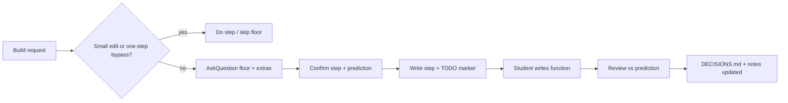

# Praxis

**Status:** Experimental (0.1.0, pre-release). Not published to the Cursor marketplace.

Praxis is a Cursor plugin for chat-first learning. A student describes what they want to build in the Agent chat they already have open. The plugin asks them to choose, one decision at a time, before that choice becomes code.

The questions use Cursor's **AskQuestion** control. Each question is written from the student's prompt. Options are not a fixed quiz. A recommendation is only a suggestion; the student selects an option.

Display name: **Praxis**. Package name: `learn-coach`. There is no setup command inside a student project.

## What Praxis does

On a **build request** (build a product, add a feature, or change how something works), Praxis runs an interview in chat before project code is written.

| Mechanism | Role |
|---|---|
| [`rules/praxis.mdc`](rules/praxis.mdc) | Always-on rule: interview flow, floor topics, predictions, marked functions |
| [`hooks/praxis.mjs`](hooks/praxis.mjs) | Session context, edit gate, one-step bypass |
| [`hooks/record.mjs`](hooks/record.mjs) | Map sync, `DECISIONS.md` export from notes |
| [`hooks/review.mjs`](hooks/review.mjs) | `TODO(praxis:…)` protection, review report |

**Floor topics** (each its own AskQuestion call, in order): level, stack, where data lives, who may see or change it, how it ships, plus anything else the prompt opens. **Skips:** named small edits (explain, rename, format, typo fix); **one-step bypass** when the student says to do just this step without questions.

**After confirmation:** one prediction sentence, then code for that step with one function left for the student (`TODO(praxis:<topic>)`). The model does not fill that function. A review compares the result to the decision and prediction.

**Hard gate:** when `.learn-coach/progress.md` has `Status: pending`, hooks deny edits to project files. Edits under `.learn-coach/` stay allowed; `Bypass: one-step` allows project edits for that one step while status can stay pending ([`gateEdit`](hooks/praxis.mjs)). `Status: confirmed`, missing progress, or a blank file does not trigger this gate (a new session may still write `Status: pending` for the floor).

## Try Praxis as a student

You need a **student project folder** (any workspace that is not this plugin repository). Do **not** run `npm install` in the student project; Praxis needs no Node dependencies there.

### Install the plugin (copy, not symlink)

Cursor loads local plugins from `~/.cursor/plugins/local/<name>/`. The tree must include at least:

- [`.cursor-plugin/plugin.json`](.cursor-plugin/plugin.json)
- [`hooks/hooks.json`](hooks/hooks.json) and the hook scripts under `hooks/`
- [`rules/praxis.mdc`](rules/praxis.mdc)

Copy the **entire** [Lazzar19/Praxis](https://github.com/Lazzar19/Praxis) clone into that folder (after clone, the repo root is usually a `Praxis` directory). **Do not** symlink your git checkout into `local/` and point elsewhere: [Cursor only loads symlinks whose target resolves inside `~/.cursor/plugins/local`](https://cursor.com/docs/plugins#test-plugins-locally).

`rsync --delete` and `robocopy /MIR` mirror the source into the destination and **remove extra files only under the destination plugin folder** (`~/.cursor/plugins/local/praxis`), not your clone.

**Unix / macOS** — run from the clone root, or set `SOURCE` to an absolute path such as `/path/to/Praxis`:

```bash
SOURCE="${SOURCE:-$PWD}"
DEST="$HOME/.cursor/plugins/local/praxis"
mkdir -p "$DEST"
rsync -a --delete --exclude node_modules --exclude .git --exclude dist \
  "$SOURCE/" "$DEST/"
```

**Windows (PowerShell)** — run from the clone root, or set `$Source` to e.g. `C:\path\to\Praxis`:

```powershell
$Source = if ($Source) { $Source } else { (Get-Location).Path }
$Dest   = "$env:USERPROFILE\.cursor\plugins\local\praxis"
New-Item -ItemType Directory -Force -Path $Dest | Out-Null
robocopy $Source $Dest /MIR /XD node_modules .git dist
# robocopy exit codes 0–7 mean success (including “extra files removed”).
```

The manifest must live at `~/.cursor/plugins/local/praxis/.cursor-plugin/plugin.json`, not under a nested folder such as `local/praxis/Praxis/.cursor-plugin/`.

After you change the plugin source, copy again and reload.

### Enable and start a session

1. Run **Developer: Reload Window** so Cursor picks up the copy.
2. Open **Customize** and enable **Praxis** if it appears in the plugin list. That toggle is for your Cursor account, not per workspace folder.
3. Open a **different** project (not this plugin repo) and start a **new Agent** chat.
4. Ask to build something. The interview should begin with AskQuestion (not plain-text quizzing).

**Praxis does not run in its own source repository.** Hooks detect this repo via `.cursor-plugin/plugin.json` plus `rules/praxis.mdc` and skip map export, `DECISIONS.md` generation, and student session behavior here. Use another folder to try a session.

## What the student meets

A build request opens the interview. Even a short prompt still covers all five floor topics, each as its own question, plus any extra decisions the prompt opens. One answer does not close two topics. Each question explains what the decision changes in this project, then each option: what it is, when to choose it, and what you give up.

Choice and reason are stored verbatim. If the reason fits a different option, that option is explained once more and they answer again; the second reason is kept.

If the repo already has source files, a map is maintained in `.learn-coach/map.md` before new questions (see [Map behavior](#map-behavior) below).

Before a confirmed step is written, they give one sentence on what they expect the code to do. The step includes one function marked `TODO(praxis:<topic>)`. They implement it. Review quotes the decision and prediction and records whether the result matched.

### When questions stay closed

- Named small edit: explain code, rename, format, fix a typo in a named place.
- One sentence to do **just this step** without questions: only that step; learning resumes on the next build request.
- `PLAN.md` alone does not disable questions. Existing source still triggers a map when relevant.

## Session lifecycle



1. Session start hook injects context (open decision, map note, practice note).
2. Model appends decisions to `.learn-coach/decisions.md`; stop/session hooks regenerate root [`DECISIONS.md`](DECISIONS.md) from those notes.
3. Stop hook clears a **one-step** bypass back to `Bypass: none`.

## Project files

`.learn-coach/` is **operational state** for the model and hooks (safe to delete to reset a session). Root `DECISIONS.md` is a **generated** readable export; edit `.learn-coach/decisions.md` if wording should change, then let hooks regenerate `DECISIONS.md`.

| File | Purpose |
|---|---|
| `.learn-coach/progress.md` | `Status:` pending \| confirmed; `Topic:`; `Bypass:` none \| one-step |
| `.learn-coach/decisions.md` | Source of truth for decisions (model appends blocks) |
| `.learn-coach/map.md` | Parts and unknowns for existing code |
| `.learn-coach/marks.md` | Tracked `TODO(praxis:…)` locations (hook-maintained) |
| `.learn-coach/review.md` | Verdict blocks: `Matched: yes` \| `no` |
| `.learn-coach/report.md` | Student-facing review summary |
| `DECISIONS.md` | Generated from `.learn-coach/decisions.md` ([templates](templates/)) |

Manual edits to `.learn-coach/` files change what the **session** hook injects on the next Agent chat, including an open `Topic` or `Bypass` state.

While `Status: pending`, edits outside `.learn-coach/` are refused except during `Bypass: one-step`.

### Map behavior

The **rule** tells the model to list described parts under **Parts** and leave unread paths under **Unknowns**. The **session hook** [`syncMap()`](hooks/record.mjs) scans the repo and, for each source file found:

- Adds a bare list entry under **Parts** (`- path`) if not already mentioned there.
- Adds the same path under **Unknowns** unless the map already has a **description** line for that path (anything more than `- path` alone).

So a newly scanned file often appears under **both** sections until the model (or you) add a description under Parts. Once `src/foo.ts` has a line like `src/foo.ts — handles auth`, later syncs stop listing it under Unknowns.

**Scan limits** ([`listCodeFiles()`](hooks/record.mjs)): max depth **12** directories; at most **40** source files; skips `node_modules`, `dist`, `.git`, `.learn-coach`. Extensions: `.ts`, `.tsx`, `.js`, `.jsx`, `.mjs`, `.cjs`, `.py`, `.go`, `.java`, `.rs`, `.rb`, `.php`, `.cs`, `.cpp`, `.c`, `.h`, `.swift`, `.kt`. If the scan hits the file cap, Unknowns gets `Further files were not listed.`

No map is written for repos with no matching source files, or for this plugin repository.

### `TODO(praxis:<topic>)` lifecycle

Hooks detect the literal substring `TODO(praxis:<topic>)` ([`MARKER`](hooks/review.mjs): `TODO(praxis:([^)]+))`). The topic may contain spaces and must not contain `)`. It can appear anywhere in source (tests use it inside a string, not only in a comment). The captured topic is matched to the decision block’s `Topic:` line for reviews.

1. After confirmation, the model writes the step and leaves **one** marked function body containing that substring.
2. **preToolUse gate** ([`protectMarkedEdit`](hooks/review.mjs)): for files that still contain a marker, an edit is **denied** if the post-edit file would **not still include every `TODO(praxis:…)` substring** present before the edit (for example replacing a `throw new Error("TODO(praxis:…)")` line with real code). Edits that leave all marker strings unchanged are allowed (see [`src/review.test.ts`](src/review.test.ts)).
3. **stop / session:** hooks scan sources, merge marks into `.learn-coach/marks.md`.
4. When the marker substring is **gone** and a **Prediction** exists on the matching decision, the hook expects a model review in `.learn-coach/review.md`; it may write `.learn-coach/report.md` for the student.

## Reset a session

In the **student project**:

1. Delete the `.learn-coach/` directory (or remove its files).
2. Optionally delete `DECISIONS.md` if you want no exported history (hooks only regenerate `DECISIONS.md` when `.learn-coach/decisions.md` exists with at least one block).
3. Start a **new Agent** chat in that project.

Hooks will not remove stale `DECISIONS.md` automatically when `.learn-coach/` is gone.

## Troubleshooting

| Symptom | Things to check |
|---|---|
| No AskQuestion / no interview | Praxis enabled in Customize? **Reload Window** after copying the plugin? Chat opened in a project that is **not** this plugin repo? |
| Stale chat after install or reload | Agent chats that **started before** reload keep old context — open a **new** Agent chat in the student project. |
| Edit denied | `.learn-coach/progress.md` may show `Status: pending` — confirm the step or finish the open question; or use a valid one-step bypass. |
| Leftover pending from an earlier try | See [Reset a session](#reset-a-session): remove `.learn-coach/`, optionally `DECISIONS.md`, then a **new** Agent chat. |
| Plugin not discovered | `.cursor-plugin/plugin.json` must sit directly under `~/.cursor/plugins/local/praxis/`, not in a nested `Praxis/` subfolder. |
| Marked function edit denied | Agent edit would drop a `TODO(praxis:…)` substring — the student implements the function (marker may live in a string literal until replaced). |
| Map looks duplicated | Expected until Parts lines have descriptions; see [Map behavior](#map-behavior). |
| `DECISIONS.md` out of date | Run a chat stop or new session so **stop** / **session** hooks run; notes must live in `.learn-coach/decisions.md`. |
| Plugin changes ignored | Re-copy to `~/.cursor/plugins/local/praxis` and **Reload Window** (live folder is the copy, not your git tree unless it is the copy). |
| Gate / map / export seem inactive | Cursor runs `node "$CURSOR_PLUGIN_ROOT/hooks/praxis.mjs" …` ([`hooks/hooks.json`](hooks/hooks.json)). If `node` is not on PATH, hooks do not run; this repository does not define Cursor’s UI for that failure. |

## Example session (outline)

Expense tracker, beginner, SQLite for where data lives:

1. New Agent chat: *"Build an expense tracker for personal spending."* Floor AskQuestion turns include level (beginner) and **Where the data lives** (SQLite).
2. After confirmation on that step, prediction: *"Opening the database creates an expenses table with amount and date columns."*
3. Model writes scaffolding and leaves one function for the student. A minimal stub the hooks recognize (same pattern as tests):

```typescript
export function openExpenseDb(): void {
  throw new Error("TODO(praxis:Where the data lives)");
}
```

4. The student replaces the body so the file no longer contains the `TODO(praxis:Where the data lives)` substring.
5. The model records `.learn-coach/review.md` with `Topic: Where the data lives` and `Matched: yes` or `Matched: no` against that prediction; stop/session hooks can write `.learn-coach/report.md`.
6. `DECISIONS.md` lists the decisions; the report quotes choice, reason, and prediction.

## Develop Praxis

This repository is the plugin. **Node.js 20+** is required for development and for hook scripts at runtime.

```bash
npm ci
npm test
npm run build   # optional: compile retired MCP server + VS Code extension bits
```

- **`npm test`** — `tsx --test` over `src/*.test.ts` and `src/extension/*.test.ts` (interview rule, gate, record, map, review, student path). No `.github` CI in this repo; run tests locally.
- **`npm run build`** — TypeScript compile plus bundle [`src/extension/extension.ts`](src/extension/extension.ts) to `dist/extension.cjs`. Also builds MCP entry [`src/index.ts`](src/index.ts). **Students do not use this build** for the chat-first path.

Follow [PLAN.md](PLAN.md) for slices and non-goals. The workspace rule [`.cursor/rules/no-code-before-export.mdc`](.cursor/rules/no-code-before-export.mdc) applies when developing here (no student interview in this repo).

### Runtime requirements

| Requirement | Detail |
|---|---|
| Node | `>=20` per [`package.json`](package.json) `engines.node`; hooks call `node` on each session / edit / stop |
| VS Code engine | `^1.95.0` in `package.json` (extension artifact only; not loaded for students) |
| Student project | No Node/npm required in the student app itself |

## Active path vs retired path

| Active (student path) | Retired (kept in repo, not started for students) |
|---|---|
| [`rules/praxis.mdc`](rules/praxis.mdc) | [`questions/core.yaml`](questions/core.yaml) fixed quiz tree |
| [`hooks/`](hooks/) + [`hooks/hooks.json`](hooks/hooks.json) | MCP chat loop in [`src/server.ts`](src/server.ts) — tools: `start_session`, `next_question`, `record_answer`, `export_decisions`, `add_project_questions`, `scaffold_todos`, `review_todo` |
| AskQuestion in chat | Question card: [`src/extension/`](src/extension/) (build → `dist/extension.cjs`) |
| `TODO(praxis:<topic>)` | `TODO(learn-coach:<questionId>)` from `scaffold_todos` |
| Empty [`mcp.json`](mcp.json) / [`.cursor/mcp.json`](.cursor/mcp.json) | `npm start` MCP server (old flow) |

[`src/path.test.ts`](src/path.test.ts) checks that shipping config does not wire the retired path (`mcp.json` and `.cursor/mcp.json` have empty `mcpServers`; no `showQuestion` in the extension source; `hooks/praxis.mjs` does not reference `core.yaml`, `scaffold_todos`, or `showQuestion`), and runs an integration case where a student project completes `DECISIONS.md` / `.learn-coach/report.md` from `TODO(praxis:…)` **without** `.learn-coach/session.json` or `questions/core.yaml`.

## Repository map

| Path | Role |
|---|---|
| `.cursor-plugin/plugin.json` | Cursor plugin manifest |
| `rules/praxis.mdc` | Shipping interview rule |
| `hooks/hooks.json`, `hooks/*.mjs` | Session, gate, record, review |
| `templates/` | `DECISIONS.md` templates |
| `src/` | Tests + retired MCP, flow, extension |
| `examples/student/` | Fixture folder (card-era README only) |
| `.cursor/hooks.json` | Dev copy of hooks for this workspace (uses relative `hooks/praxis.mjs`) |
| `PLAN.md` | Product plan |

## Known limitations

- Pre-release, local-install oriented; marketplace publishing is a later goal ([PLAN.md](PLAN.md)).
- Map scan is shallow (depth 12, 40 files) and may omit large monorepos.
- Map sync lists new files under both Parts and Unknowns until described (rule vs hook mismatch).
- Interview quality depends on the model following `rules/praxis.mdc` (rule); gates enforce files and markers, not every AskQuestion nuance.
- Retained MCP/extension code can confuse readers; it is not on the student path.

## Plan

Roadmap and locked decisions: [PLAN.md](PLAN.md).
