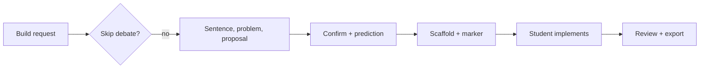

# Praxis

**Status:** Experimental (0.1.0, pre-release). Not published to the Cursor marketplace.

Praxis is a Cursor plugin for chat-first learning. A student describes what they want to build in the Agent chat they already have open. The plugin asks them to choose, one decision at a time, before that choice becomes code.

The student states the architecture in their own words. Praxis names one problem in that sentence and puts one proposal beside it. The student then chooses, with **AskQuestion**: keep theirs, take the proposal, or mix the two. That choice is the decision.

Display name: **Praxis**. Package name: `learn-coach`. There is no setup command inside a student project.

## Demo

A screen recording of a real Cursor session is not included yet. The **illustrative chat transcript** below shows the conversation, and the **captured hook run** shows what the plugin actually enforces on disk.

<!-- Owner: add a real session recording as docs/demo.gif when available. -->

### Illustrative chat transcript (not captured)

Family expense tracker — shapes match [`rules/praxis.mdc`](rules/praxis.mdc); wording is an example only.

| Turn | Who | Content |
|------|-----|---------|
| 1 | Student | "Build an expense tracker for our family. A JSON file on the laptop is enough, with no accounts." |
| 2 | Agent | Restates that sentence. One problem: someone else on that laptop can open the file and change an expense. |
| 3 | Student | "I would hide the file, but they can still find it." |
| 4 | Agent (AskQuestion) | Proposal beside that sentence: SQLite on the same laptop, still no accounts. Options: keep theirs, take the proposal, or mix the two. |
| 5 | Student | Takes the proposal. Reason: SQL queries and offline use for the family budget. |
| 6 | Agent | Asks for one prediction sentence before code. |
| 7 | Student | "It saves a new expense and returns its generated id." |
| 8 | Agent | Writes scaffolding and leaves `saveExpense` with `TODO(praxis:Where the data lives)` in the body. **Do not ask Praxis to remove or implement the marked function.** The marker is the boundary between generated scaffolding and the student's implementation. |
| 9 | Student | Implements `saveExpense` in the editor. |
| 10 | Agent | Reviews against the prediction; records `Matched: yes` or `no` in `.praxis/review.md`. |

The **topic string inside the marker** must match the decision block's `Topic:` line (`Where the data lives` in the hook demo below).

### Captured hook run (real `node hooks/praxis.mjs …`)

Reproduce from the plugin root:

```bash
node docs/demo-session.mjs
```

The script creates a throwaway project under `/tmp`, drives `session`, `gate`, and `stop` with the same stdin JSON shapes as the tests, checks results, and cleans up. In a real session, **`Matched: yes` / `no` in `.praxis/review.md` is written by the model** ([`rules/praxis.mdc`](rules/praxis.mdc)); hooks only **read** `review.md` and may generate `.praxis/report.md` on `stop` / `session`. The demo driver **simulates** the model by writing `review.md` before the final `stop` — that step is not a hook.

Full stdout from one run is in [`docs/demo-run.txt`](docs/demo-run.txt) (paths under `/tmp/…` vary per run).

Trimmed excerpts (from a real run; `…` omits the rest of the on/off guidance):

```
=== 1 session ===
stdout JSON keys: additional_context
...
This project has not chosen Praxis yet.
...
two options: turn Praxis on for this project, or leave it off.

=== 2 gate Write (leave Praxis off) ===
{"permission":"deny","user_message":"Praxis is off for this project. No notes are kept.",...}

=== 5 gate StrReplace (marker removal) ===
{"permission":"deny","user_message":"Praxis left TODO(praxis:Where the data lives) for you to write.",...}

=== 6 stop (report.md, after the driver wrote review.md and the student code) ===
# Review
...
Matched: yes
```

## Example session

The [Demo](#demo) table is the narrative version of one round: their sentence, one problem, one proposal, then the choice. The hook demo uses this stub (same pattern as [`src/review.test.ts`](src/review.test.ts)):

```typescript
export function saveExpense(): number {
  throw new Error("TODO(praxis:Where the data lives)");
}
```

## Try Praxis as a student

You need a **student project folder** (any workspace that is not this plugin repository). Do **not** run `npm install` in the student project.

### Install the plugin (copy, not symlink)

Cursor loads local plugins from `~/.cursor/plugins/local/<name>/`. The tree must include [`.cursor-plugin/plugin.json`](.cursor-plugin/plugin.json), [`hooks/hooks.json`](hooks/hooks.json) with scripts under `hooks/`, and [`rules/praxis.mdc`](rules/praxis.mdc).

Copy the entire [Lazzar19/Praxis](https://github.com/Lazzar19/Praxis) clone (folder name is usually `Praxis`). Do not symlink a checkout that resolves outside `local/`: [Cursor docs](https://cursor.com/docs/plugins#test-plugins-locally).

`rsync --delete` and `robocopy /MIR` mirror into the destination and **remove extra files only under** `~/.cursor/plugins/local/praxis`, not your clone. **Prefer `robocopy /MIR` over `Copy-Item .\*` on Windows** — a plain copy would also drag `.git` and `node_modules` unless you exclude them by hand.

**Unix / macOS** (from clone root, or `SOURCE=/path/to/Praxis`):

```bash
SOURCE="${SOURCE:-$PWD}"
DEST="$HOME/.cursor/plugins/local/praxis"
mkdir -p "$DEST"
rsync -a --delete --exclude node_modules --exclude .git --exclude dist \
  "$SOURCE/" "$DEST/"
```

**Windows (PowerShell)** (from clone root, or `$Source = 'C:\path\to\Praxis'`):

```powershell
$Source = if ($Source) { $Source } else { (Get-Location).Path }
$Dest   = "$env:USERPROFILE\.cursor\plugins\local\praxis"
New-Item -ItemType Directory -Force -Path $Dest | Out-Null
robocopy $Source $Dest /MIR /XD node_modules .git dist
# exit codes 0–7 = success
```

`.cursor-plugin/plugin.json` must live at `local/praxis/.cursor-plugin/`, not `local/praxis/Praxis/.cursor-plugin/`.

### Enable and start

1. **Developer: Reload Window**
2. **Customize** → enable **Praxis** (account-level, not per folder)
3. Open a **different** project and a **new** Agent chat
4. Ask to build something; expect AskQuestion, not a plain-text quiz

**Praxis does not run in this source repo.** Hooks detect `.cursor-plugin/plugin.json` plus `rules/praxis.mdc` and skip student map/export behavior here.

**Reset a session:** in the student project, delete `.praxis/`, optionally `DECISIONS.md`, then open a **new** Agent chat. Hooks do not delete stale `DECISIONS.md` when notes are gone.

## What the student meets

A build request starts a debate, one round at a time. Praxis takes their architecture sentence, names one problem in it, and puts one proposal beside that sentence. They keep theirs, take the proposal, or mix the two. Level is one short question and is not a debate. The stack, where data lives, who may see or change it, and how it ships are the other rounds, plus a decision their prompt opens. One answer does not close two topics.

Reasons, the reply to the problem, and the proposal are stored verbatim. A reason that fits another option gets one retry.

The first question in a new project is a choice: turn Praxis on, or leave it off. Off keeps no `.praxis` directory and no notes. Asking in chat to turn Praxis on is when that directory and the debate begin.

**Skips:** named small edits; **one-step bypass** for a single step without questions (resets on stop).

Existing code triggers a map under `.praxis/map.md` before new questions (see [How it works](#how-it-works)).

After confirmation: one prediction sentence, then code with one `TODO(praxis:<topic>)` function for the student. Review compares the implementation to the prediction.

## Session lifecycle

1. Student opens a **new** Agent chat and asks to build or change something substantial.
2. **sessionStart** hook runs. A project with no choice is asked on or off, and `.praxis` is not created yet. Off stays quiet with no notes. On writes `.praxis/progress.md` and the next beat is their sentence, before any option list.
3. Model runs one debate round, then **AskQuestion** for keep, take, or mix. Confirmed blocks go to `.praxis/decisions.md`.
4. While **`Status: pending`**, **preToolUse** denies project file edits (notes and one-step bypass excepted).
5. Student confirms a step; model records **Prediction** and sets progress to **`confirmed`** when appropriate.
6. Model writes the step and leaves the **TODO(praxis:…)** marker in one function.
7. **preToolUse** denies edits that drop marker substrings until the student implements.
8. Student implements the function (marker gone).
9. Model writes `.praxis/review.md` (`Matched: yes` | `no`); **stop** / **session** may refresh `.praxis/report.md` and root **DECISIONS.md**.
10. Next build request or chat continues from `.praxis/progress.md` and notes.



## What gets written

From [`docs/demo-session.mjs`](docs/demo-session.mjs) (expense tracker with existing `src/db.ts`):

**Before first hook run**

```text
student-project/
└── src/db.ts          # existing sample code (map scan finds it)
```

**After `session`**

```text
student-project/
├── .praxis/
│   ├── progress.md    # Status: pending, open beat
│   └── map.md         # Parts + Unknowns from listCodeFiles
└── src/db.ts
```

**After model writes decision + stub, then `stop`**

```text
student-project/
├── .praxis/
│   ├── progress.md    # often Status: confirmed
│   ├── decisions.md   # operational source of truth (append blocks)
│   ├── map.md
│   └── marks.md       # Topic / File / Function from TODO scan
├── DECISIONS.md       # generated from decisions.md
└── src/
    ├── db.ts
    └── expenses.ts    # stub still contains TODO(praxis:…)
```

**After student implementation + `review.md` + `stop`**

```text
student-project/
├── .praxis/
│   ├── …              # progress, decisions, map, marks
│   ├── review.md      # Matched: yes|no — **model-written** (driver fakes this in the demo)
│   └── report.md      # **hook-generated** on stop from review.md + decisions
├── DECISIONS.md
└── src/expenses.ts    # marker removed — student implementation
```

Manual edits under `.praxis/` change what the **session** hook injects on the next chat (open `Topic`, `Bypass`, etc.). While `Status: pending`, edits outside `.praxis/` are refused except during `Bypass: one-step`.

## Troubleshooting

| Symptom | Things to check |
|---|---|
| No AskQuestion | Praxis enabled? **Reload Window**? Student project (not plugin repo)? **New** Agent chat? |
| Stale chat after reload | Chats started before reload — open a **new** Agent chat |
| Edit denied (`pending`) | Finish or confirm open topic in `.praxis/progress.md`, or valid one-step bypass |
| Leftover pending | [Reset a session](#try-praxis-as-a-student) |
| Plugin not loaded | `plugin.json` directly under `local/praxis/`, not nested `Praxis/` |
| Marker edit denied | Agent must not remove `TODO(praxis:…)`; student implements |
| Map duplicated paths | [Map behavior](#map-behavior) until Parts lines have descriptions |
| `DECISIONS.md` stale | Trigger **stop** / **session**; need `.praxis/decisions.md` blocks |
| Plugin changes ignored | Re-copy to `local/praxis` and reload |
| Hooks inactive | `node` on PATH for `hooks/hooks.json`; if missing, hooks do not run (undefined UI here) |

## How it works

| Piece | File | Role |
|---|---|---|
| Rule | [`rules/praxis.mdc`](rules/praxis.mdc) | Debate, prediction, marker contract |
| Session / gate | [`hooks/praxis.mjs`](hooks/praxis.mjs) | Context, `Status: pending` gate, one-step bypass |
| Record | [`hooks/record.mjs`](hooks/record.mjs) | `syncMap`, `DECISIONS.md` from notes |
| Review | [`hooks/review.mjs`](hooks/review.mjs) | Marker guard, `marks.md`, `report.md` |

**Gate:** `Status: pending` blocks project edits; `.praxis/` allowed; `Bypass: one-step` allows one step; `confirmed` or empty progress does not block ([`gateEdit`](hooks/praxis.mjs)).

**Marker:** `TODO(praxis:<topic>)`, optionally `TODO(praxis:<topic>): the expected piece`. One mark is the default. A step may leave more than one mark with the same topic, and each is counted, so removing one of them is denied. A function that still has the mark and already has some body is in progress: the mark stays, and the model is told to offer the next small step. [`protectMarkedEdit`](hooks/review.mjs) denies edits that remove a mark (see [`src/review.test.ts`](src/review.test.ts)). **Do not ask the agent to remove or finish the marked function** — that is the student's step.

### Map behavior

[`syncMap()`](hooks/record.mjs) adds each scanned file under **Parts** and also under **Unknowns** until Parts has a description that is not only a role hint. A known file gets a role hint such as `data access`, `API boundary`, `test`, `deployment`, or `package manager`. **Limits:** depth 12, max 40 files, with role files kept ahead of plain source; skips `node_modules`, `dist`, `.git`, `.praxis`. No map without matching files or in the plugin repo.

## Known limitations

- Pre-release; local install; marketplace later ([PLAN.md](PLAN.md)).
- Shallow map scan; duplicate Parts/Unknowns entries until described.
- AskQuestion nuance is rule-driven; hooks enforce files and markers only.
- [`src/path.test.ts`](src/path.test.ts): empty MCP wiring, hook sources omit retired symbols; integration without `session.json` / `questions/core.yaml`.

## Develop Praxis

Node **20+** required for `npm ci` / `npm test` and for hook scripts at runtime in Cursor.

```bash
npm ci
npm test
npm run build   # retired MCP + extension artifacts
```

No `.github` CI — run tests locally. [`package.json`](package.json): `engines.node >=20`, `vscode ^1.95.0` (extension only). Student apps need no Node.

Follow [PLAN.md](PLAN.md). Workspace rule [`.cursor/rules/no-code-before-export.mdc`](.cursor/rules/no-code-before-export.mdc): do not run the student interview against this repo.

## Retired compatibility path

These remain for **tests and compatibility only** and may be removed in a later cleanup. Students on the shipping path use the rule and hooks only.

| Active | Retired |
|---|---|
| `rules/praxis.mdc` + `hooks/` | [`questions/core.yaml`](questions/core.yaml) |
| AskQuestion + `TODO(praxis:…)` | MCP [`src/server.ts`](src/server.ts): `start_session`, `next_question`, `record_answer`, `export_decisions`, `add_project_questions`, `scaffold_todos`, `review_todo` |
| Empty [`mcp.json`](mcp.json) / [`.cursor/mcp.json`](.cursor/mcp.json) | Question card [`src/extension/`](src/extension/) → `dist/extension.cjs` |
| Notes → `DECISIONS.md` via hooks | `TODO(learn-coach:…)` from `scaffold_todos`; `npm start` MCP server |
| | [`src/render.ts`](src/render.ts) **`writeExport`** writes `DECISIONS.md` and `PLAN.md` directly from YAML session state (old MCP flow only — not the hook export) |

## Repository map

| Path | Role |
|---|---|
| `.cursor-plugin/plugin.json` | Manifest |
| `rules/praxis.mdc` | Shipping rule |
| `hooks/` | Student hooks |
| `docs/demo-session.mjs` | Reproducible hook demo |
| `templates/` | `DECISIONS.md` templates for hook export |
| `src/` | Tests + retired MCP, flow, extension |
| `examples/student/` | Legacy fixture note |
| `.cursor/hooks.json` | Dev workspace hooks |
| `PLAN.md` | Plan |

## Plan

[Roadmap and locked decisions](PLAN.md).
